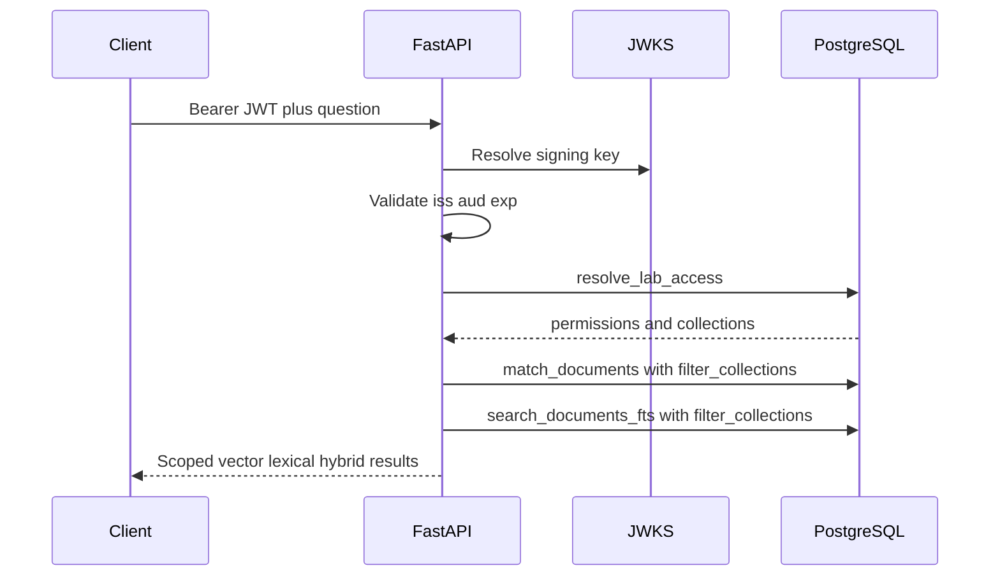

# Security architecture

This document describes how authentication and authorization work in this iteration of the Retrieval Lab.

## 1. Identity provider and JWT issuance

This API does not issue tokens. A corporate identity provider (IdP) signs JWT access tokens. Each token must include at least:

- `iss` (issuer)
- `sub` (subject)
- `aud` (audience configured for this API)
- `exp`

Roles and collection scopes are **not** taken from JWT claims. They are loaded from PostgreSQL after the token is validated.

## 2. JWT validation in FastAPI

`POST /ingest` and `POST /query` require `Authorization: Bearer <token>`.

Validation is implemented in [retrieval_lab/auth/jwt_validator.py](retrieval_lab/auth/jwt_validator.py):

- Signing keys are resolved from `JWT_JWKS_URL` using `PyJWKClient` (cached keys support rotation).
- The validator checks issuer, audience, expiration, and allowed algorithms (`JWT_ALGORITHMS`, default `RS256`).
- Missing or invalid tokens return **401**.

`GET /health` stays unauthenticated.

## 3. Identity resolution (`issuer` + `sub`)

After validation, the API builds a `Principal(issuer, subject)` and calls `resolve_lab_access` in the database. The client never supplies user ids or permissions that the server trusts.

## 4. RBAC in PostgreSQL

Migration [sql/002_auth_rbac.sql](sql/002_auth_rbac.sql) defines:

- `lab_identities (issuer, subject)`
- `lab_permissions` with `documents:read` and `documents:write`
- `lab_collection_grants` with `allow_read` / `allow_write` per collection name

Access is resolved by RPC `resolve_lab_access(p_issuer, p_subject)` (execute granted only to `service_role`).

## 5. Document collection authorization

- Each chunk row has `documents.collection` (existing rows backfill to `legacy`).
- `/ingest` requires form field `collection` plus `documents:write` on that collection.
- `/query` requires `documents:read`. Optional JSON field `collections` is intersected with server-side read grants; requesting a forbidden collection returns **403**.

## 6. Authorized scopes in SQL retrieval

The old two-argument RPCs were **dropped**:

- `match_documents(vector, int)`
- `search_documents_fts(text, int)`

They are replaced by:

- `match_documents(vector, int, filter_collections text[])`
- `search_documents_fts(text, int, filter_collections text[])`

Both apply `d.collection = ANY(filter_collections)` **before** `LIMIT` and ranking. An empty filter array returns no rows.

The Python layer passes only collections derived from `resolve_lab_access` (and optional client subset after authorization checks). It does not post-filter results to hide unauthorized chunks.

## 7. Is RLS enforced?

**Not for the API’s Supabase secret key.** The server uses the service key, which bypasses Row Level Security on `documents`.

Authorization tables have RLS enabled and privileges revoked from `anon` and `authenticated`, so they are not readable through the public Supabase Data API. That does **not** stop a holder of the service key from reading them directly.

This design is **application-enforced isolation** plus SQL collection filters inside trusted RPCs. It is not database-enforced multi-tenant isolation.

## 8. Limitations and production gaps

- Compromise of `SUPABASE_KEY` or the API host exposes all data and auth tables.
- No token revocation list, no mTLS, no per-tenant rate limits, no audit log.
- `python -m retrieval_lab.evaluate` and `test_connections.py` bypass JWT (operator tooling).
- JWKS URL must be reachable from the API process (except in tests using `LocalJwtValidator`).

## Sequence (query)



## Local testing (no production secrets)

Unit tests generate an ephemeral RSA key pair in [tests/conftest.py](tests/conftest.py). They use `LocalJwtValidator` and `MemoryStore` grants. No private key is committed.

To mint a manual test token against your IdP, use your organization's token tool. For database-backed tests, apply [sql/002_auth_rbac.sql](sql/002_auth_rbac.sql) and optionally [sql/002_seed_dev_identities.example.sql](sql/002_seed_dev_identities.example.sql), then set `JWT_*` variables in `.env` from [.env.example](.env.example).

Example API calls:

```bash
curl -s http://127.0.0.1:8000/health

curl -s -H "Authorization: Bearer $TOKEN" \
  -F file=@doc.pdf -F collection=legacy \
  http://127.0.0.1:8000/ingest

curl -s -H "Authorization: Bearer $TOKEN" \
  -H "Content-Type: application/json" \
  -d '{"question":"What are the risks?","collections":["legacy"]}' \
  http://127.0.0.1:8000/query
```
